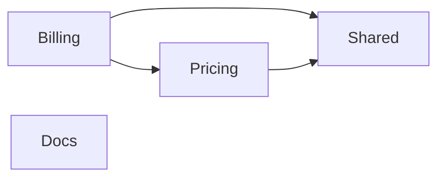

# Markdown Projection

The convention for deterministically deriving human- and AI-readable Markdown from the IR (`aburi.ir.v1`) and the Diff (`aburi.diff.v1`).

See:
- [`ir-schema.md`](./ir-schema.md) — the data structures the projection is derived from
- [`diff-algorithm.md`](./diff-algorithm.md) — the source data for the diff Markdown
- [`extension-vocab.md`](./extension-vocab.md) — display units for vocab

---

## 1. Purpose

The L3 IR is JSON that prioritizes machine readability above all.
It is rendered as Markdown to serve three human + AI use cases: "viewed in a PR comment", "read on first contact with a repository", and "querying a single symbol via `aburi explain`".

The projection is **deterministic**: the same IR always produces the same Markdown.

## 2. Output file layout

```
out/
├─ workspace.md                       # L0 monorepo overview
├─ components/
│  ├─ billing.md                      # L1 + L2 (all symbols of the billing component)
│  ├─ pricing.md                      # L1 + L2
│  └─ shared.md                       # L1 + L2
├─ diff.md                            # output of aburi diff
├─ diff.full.md                       # aburi diff --max-bytes, only when the cap shortened diff.md
└─ symbols/                           # generated individually by aburi explain (on demand)
   └─ ts-apps-billing-src-InvoiceService-ts-InvoiceService-createInvoice.md
```

- workspace.md: always a single file, and removed by an `aburi scan --format json`
- `components/<id>.md`: one file per component (L1 + L2 combined), and, after an `aburi scan`,
  none for a component the IR does not hold: `aburi scan` removes the page of one renamed or
  removed since, and every page under `--format json`, recognising a page by its name and its first
  line, `# Component: <id>` (§5.1), so files of anyone else's in `components/` stay
  ([`cli-spec.md`](./cli-spec.md) §5.3)
- diff.md: generated only when `aburi diff` runs
- diff.full.md: the same diff with no size cap, written only when `--max-bytes` changed `diff.md`
  and removed by every other `aburi diff` run (§6.4)
- symbols/: generated only when `aburi explain` runs

### 2.1 Why L2 is combined per component

One file per symbol would explode the file count (hundreds to thousands) and scatter git diffs.
L1 (architecture) and L2 (symbol details) are combined within a component: 1 component = 1 file.

If a huge component (>500 symbols) becomes hard to read, a future split into `components/<id>/symbols.md` will be considered, but currently the combined form is kept.

## 3. Common format conventions

### 3.1 Markdown dialect

- CommonMark + GitHub-Flavored Markdown (tables / `<details>` / fenced code blocks)
- mermaid diagrams use ```` ```mermaid ```` fences (GitHub native rendering)
- HTML tags are limited to `<details>` / `<summary>` / `<sub>` (kept minimal for CommonMark compatibility)

### 3.2 Ordering conventions (fixed for diff stability)

| Target | Order |
|---|---|
| Component | ascending by `id` |
| Files (within a component) | ascending by `path` |
| Symbol (within a file) | ascending by `source.startLine` (ties broken by `id` ascending) |
| Decorator (display) | ascending by `line` |
| Rule / Effect / Call | ascending by `line` (= source order) |
| Dependency | lexicographic by `(from, to, via)` |
| Diff symbol entries (within each section) | ascending by `id` |

The ordering conventions match the JSON side (ir-schema §1). If the projection changed the order, diffs would become meaningless.

### 3.3 Path display

- Always POSIX (forward slashes)
- Relative to the workspace root
- Wrapped in backticks: `` `apps/billing/src/InvoiceService.ts` ``

### 3.4 Code fragment display

| Length | Display |
|---|---|
| ≤ 80 chars | inline backticks: `` `customer.creditLimit < invoice.total` `` |
| > 80 chars or multiline | fenced code block (no language hint) |
| Original canonical string exceeds 120 chars | already truncated with a trailing `...` at the IR stage ([`ir-schema.md`](./ir-schema.md) §8.2), so used as-is |

Both forms size their fence to the value rather than assuming one. A code span opens and closes
with one more backtick than the longest run inside it. A fenced block opens with three backticks,
or one more than the longest run in the source where that is longer. Everything a projection puts
in a code span goes through this rule: `` key === `x-${plugin}:write` `` is ordinary TypeScript,
and under a fixed single backtick it would close the span at its own first backtick and spill the
rest of the row into the document as Markdown.

A span whose value opens or closes with a backtick also carries a space of padding at each end,
for two separate reasons worth keeping apart:

- **It is needed.** CommonMark reads the delimiter as a run of backticks, so a value beginning
  with one extends that run: two backticks of delimiter against a value starting with a backtick
  is a three-run against a three-run, and the delimiters are consumed instead of delimiting. The
  space is what separates the value from the run — the spec says as much.
- **It is safe.** The parser removes one space from each end again, but only when the content
  *both* begins and ends with a space and is not made entirely of spaces. Hence padding on both
  ends or neither. The one value this cannot round-trip is an all-space one: a single space
  renders as three, because the stripping rule declines to touch it.

Newlines collapse to a single space inside a code span, because a span belongs to one row. A
value that needs its lines is a fenced block instead — and a fenced block cannot sit mid-row:
it ends the list item it was written into unless it is indented to the item's content column
(§5.6).

A value with nothing in it gets no span at all — `` is two literal backticks, not an empty code
span — so it renders as `(empty)`. Emitting nothing is the failure this replaces: it is
indistinguishable from an absent field, and one level up it deletes the row that was about to
report the change.

#### 3.4.1 Table cells

GFM resolves table cells before it parses inlines, so a `|` in a value opens a column the header
row never declared and every cell after it shifts left — inside a code span too, where a reader
would expect the pipe to be literal. Every cell this projection emits therefore escapes `|` as
`\|`, which the row scanner reads as a literal pipe, and maps newlines to `<br>`.

The scanner reads a backslash and the character after it as one escape pair, so a value that
already contains `\|` needs its backslash doubled first: escaped naively it becomes `\\|`, where
the first backslash consumes the second and the pipe delimits again. Only a backslash run
directly in front of a pipe is doubled, so a path elsewhere in the cell keeps its backslashes.
The cost is one visible backslash inside the code span, which is the price of a column that
still lines up; GFM has no encoding that avoids both.

Which cells can actually carry one is narrower than it looks: `ComponentId` is kebab-case,
`EffectId` is a frozen enum or an `x-…` pattern, and `RelativePath` and `SymbolId` forbid
backslash outright. `RelativePath` admits `|`, and `Call.target` (`minLength: 1`, nothing else)
admits both. The escaping is applied to every cell regardless — a table whose correctness
depends on which column the value landed in is one schema change away from being wrong.

#### 3.4.2 Values in a row

A value the IR, the diff or the config supplies goes in a code span wherever a row names it,
free-form text included: a thrown type (§5.5), a propagated effect's direct sources (§5.7), a
Component's `name` (§5.1), a component-level Dependency endpoint (§4.1, §5.1), the generator's
`name` and `version` and the `generatedAt` of the `workspace.md` header (§4.1), a `dropReason`
(§3.6, §6.2, §7) and each ref of the `diff.md` title (§6.1). Written bare, the value is read as
Markdown, and what a reviewer sees is no longer what the IR holds:

- `_` and `*` open emphasis: `ts:src/__generated__/client.ts#save` renders `generated` in bold
  and drops the underscores, naming a different path, and a `frameworkHints` drop reason ending
  `class *Payload*` loses its glob to italics.
- A `<…>` that parses as a tag is raw HTML, which GitHub's sanitizer then removes:
  `ApiError<NotFound>` reads `ApiError`, while `Map<string, number>` stays as written.
- A newline starts a block: a name holding `\n## Beta` writes a heading of its own, and one
  holding `<details>` an unclosed fold that swallows the rest of the page.
- GFM's strikethrough takes a single `~`, so a title of `HEAD~2..HEAD~1` would strike out
  `2..HEAD`.
- On GitHub, `@name` becomes a mention and `#123` an issue link. A decorator `frameworkHints`
  drop reason reads `frameworkHints "x": @AcmeDto` and reaches Dropped changes in the PR
  comment, and a Component's `name` defaults to its manifest name, often `@scope/pkg`.

A span is the one construct none of these reach, with its fence sized and its newlines
collapsed as above. Backslash escapes would keep `main..HEAD` byte for byte, and are not used:
the characters to escape are a list that grows with every extension the renderer turns on (`~`
is GFM's), and a newline still cannot sit inside a heading or a list item's row.

What a row writes bare is what admits no Markdown by its grammar: `ComponentId`, `LanguageId`,
`EffectId`, plugin, framework and package-manager names, the schema's enums (`kind`,
`visibility`, `confidence`, a skip reason, a change status), counts, line numbers, and a ref of
the `diff.md` title that is a commit SHA, 7 to 40 lowercase hex digits (§6.1). A component-level
Dependency endpoint names a Component id, but the schema holds it to nothing but `minLength: 1`
and the integrity check reads only the endpoints shaped like a Symbol id, so it is spanned like
any other value. The headings, labels and notes around the values are the projection's own
fixed text (§10).

### 3.5 Confidence badges

| Value | Display |
|---|---|
| `high` | no badge (default) |
| `medium` | `⚠ medium` |
| `low` | `⚠ low` |

Low-confidence symbols/effects explicitly signal "the machine is not confident" to reviewers. An effect carries the badge at the end of its row (§5.7). A Symbol carries it after its name and kind on every heading that names it — the component page (§5.2), every `diff.md` entry that renders the Symbol under its own heading (§6.2), the `explain` title (§7), dropped or not — and on the names-only row that stands in for such a heading when the size cap shortens a section (§6.4), so no Symbol a view gives its own heading or row loses the badge. Rows that list a Symbol among other facts (Moved, Dropped changes, the Slice View members) do not carry it.

### 3.6 dropped display

Dropped symbols are shown in a `## Dropped` section inside a `<details>` fold:

```md
## Dropped

<details>
<summary>14 dropped symbols</summary>

- `ts:apps/billing/src/dto/create-invoice.dto.ts#CreateInvoiceDto` — `pure DTO`
- `ts:apps/billing/src/types.ts#Invoice` — `interface (data model)`

</details>
```

## 4. L0 — `workspace.md`

The monorepo overview.

### 4.1 Structure

The example draws Component edges, which the IR can carry and `aburi scan` does not write yet
(§4.2): against a scanned workspace the graph holds the nodes alone.

````md
# Workspace

**Languages**: ts, py
**Managers**: pnpm (`apps/*`, `packages/*`), uv (`services/*`)
**Symbols**: 542 kept · 87 dropped (across 1234 files)
**Generated**: `aburi` `1.0.0`

## Components

| id | roots | languages | frameworks | symbols |
|---|---|---|---|---|
| billing | `apps/billing`, `packages/billing-domain` | ts | nestjs | 89 |
| docs    | `docs`                                    | ts | —      | 4  |
| pricing | `packages/pricing` | ts | — | 42 |
| shared  | `packages/shared`  | ts | — | 31 |

## Component dependencies



Fallback list:

- `billing` → `pricing` (via `import`)
- `billing` → `shared` (via `import`)
- `pricing` → `shared` (via `import`)

## Files not analysed

3 of 1234 file(s) produced no Symbols.

- **over-size** (2):
  - `apps/web/public/bundle.js`
  - `packages/gen/schema.ts`
- **parse-failed** (1):
  - `apps/web/src/route.ts`

## Effect surface (top 10 by count)

| effect | count | components |
|---|---|---|
| db.read | 41 | billing, pricing |
| db.write | 23 | billing |
| network.http | 8 | shared |
| event.publish | 5 | billing |
...
````

**Files not analysed** is emitted only when `stats.skippedFiles` is non-empty (`ir-schema.md` §2), grouped by reason because the shape — one file, or all of them — is the thing to notice before the paths are. A document that predates the field omits the section rather than rendering it empty: "this run lost nothing" and "this writer could not say" are different answers, and the **Symbols** header line above distinguishes them by reporting `parsedFiles` beside `totalFiles` whenever the two differ.

### 4.2 mermaid

Every component declared in `ir.components` renders as a mermaid node — even
isolated ones with no incident dependencies — so the L0 view matches the
"full monorepo view" contract of [`overview.md`](./overview.md) §3.1
(`docs` above is such a node). Node declarations are ordered ascending by
`id`; edges are ordered lexicographically by `(from, to, via)`. Component
ids are ASCII kebab-case per [`ir-schema.md`](./ir-schema.md) §4, written
as mermaid node ids in snake_case behind a `c_` prefix (`billing-api` →
`c_billing_api`), in node declarations and edges alike. The mapping is
injective because ComponentId cannot contain `_`. The prefix is there
because mermaid's flowchart grammar reads several valid ComponentIds as
keywords — `graph`, `flowchart`, `subgraph`, `end`, `style`, `class` and
`interpolate` as a declaration, `click`, `call` and `href` at either end of
an edge — and one such node id fails the whole block, or, for `click` at the
start of an edge, turns the line into a click statement that drops the
edge. No prefixed id is one of them, and a prefix keeps holding when a
mermaid release adds a keyword, which a list of the keywords to avoid would
not. Labels use `Component.name` with mermaid-hostile characters (`&`,
`"`, `<`, `>`, `]`) escaped and each line ending, a lone `\r` included,
written as `<br/>`, so the `id["label"]` syntax stays intact and no line of
a label can close the mermaid fence.

If the union of declared components and edge endpoints exceeds 100 nodes,
the mermaid block is replaced by an explicit `_Component graph omitted…_`
note so a missing diagram is not mistaken for a broken renderer, and only
the text list is emitted (avoids unreadability).

The mermaid block, or the note that replaces it, is always followed by
`Fallback list:` and the text form of the edges: one bullet per Component
edge, ``- `<from>` → `<to>` (via `<via>`)`` in edge order, or
`_No Component edges recorded._` when there is none. The list is emitted
with no edge too, because a reader looking at a block that failed to render
cannot otherwise tell whether it held any edge; every node is a Components
table row or an endpoint named in the list. The sentence says what the IR
records, not that the components are independent: `aburi scan` writes Symbol
edges only. A workspace with no component and no Component edge has no
diagram, and the section is that sentence alone.

### 4.3 generation metadata

The `**Generated**` line names the generator. Its ` at <time>` tail is displayed only when `generatedAt` is present in the IR, which no writer emits today ([`ir-schema.md`](./ir-schema.md) §2), and omitted under `--no-timestamp`.

## 5. L1 + L2 — `components/<id>.md`

The component's logical boundary + full details of every symbol belonging to that component.

### 5.1 Structure

```md
# Component: billing

**Name**: `Billing`
**Roots**: `apps/billing`, `packages/billing-domain`
**Languages**: ts
**Frameworks**: nestjs
**Symbols**: 89 kept · 14 dropped

## Public API

- `apps/billing/src/routes/**`
- `ts:packages/billing-domain/src/index.ts#Invoice`

## Dependencies

- `billing` → `pricing` (via `import`)

## Symbols

(symbol rendering per §5.2 follows)

## Dropped

(§3.6)
```

### 5.2 Symbol display

Grouped by file; within a file, ascending by source.startLine:

```md
### `apps/billing/src/InvoiceService.ts`

#### `InvoiceService.createInvoice` *(method)*
**Boundary**: `@Post('/invoices')` `@UseGuards(AuthGuard)`
**Signature**: `(customerId: CustomerId, items: LineItem[]) → Promise<Invoice>` throws `CreditLimitExceeded` ⚡async
**Rules**:
- guard: `customer.creditLimit < invoice.total` (L58)
- throw: `new CreditLimitExceeded(customer.id, invoice.total)` (L60)
- return: `{ ...invoice, status: 'created' }` (L80)

**Effects**:
- db.write: `prisma.invoice.create` (L75) [effects-prisma]
- event.publish: `eventBus.emit` (L78) [effects-nest] ⚠ medium

**Calls**:
- `pricing.calculateTotal` (L70)

<sub>api=`9ee77913af43` logic=`7ecf8c1cebe7` syntax=`a3f2e1d0c9b8`</sub>
```

A Symbol whose `confidence` is not `high` carries the badge (§3.5) at the end of its heading, as
`#### \`XController\` *(class)* ⚠ medium`.

A target called from more than one line is one **Calls** row that lists each line,
``- `logger.warn` (L12, L30, L44)``, and the rows follow the line each target is first called on.
A body that logs ten times listed `logger.warn` ten times: in the Added and Removed entries of 45
of Aburi's own pull requests, 763 of 4,304 call rows repeated a target already listed. The
`aburi explain` page groups its **Calls** the same way (§7); its Call resolution table, when it has
one, still gives each unresolved call a row of its own, as each has its own reason.

A blank line follows each list section that something comes after. Without it, the next label
or the `<sub>` line is a lazy continuation of the last bullet's paragraph and renders inside that
bullet, except after a fenced rule row, which a paragraph cannot continue (MP14).

### 5.3 Section omission conventions

If a symbol's field is empty, the corresponding section is not emitted:

- `decorators[]` empty → omit the **Boundary** / **Decorators** line
- `signature: null` → omit the **Signature** line
- `rules[]` empty → omit the **Rules** section
- `effects[]` empty → omit the **Effects** section
- `calls[]` empty → omit the **Calls** section

A symbol with everything empty (class without boundary, no methods) is normally dropped, but a module class that carries only a boundary decorator, for example, shows the Boundary line only.

### 5.4 Decorator display

| Kind | Rendered line |
|---|---|
| boundary=true only | `**Boundary**: \`@A\` \`@B\`` |
| boundary=false only | `**Decorators**: \`@A\` \`@B\`` |
| mixed | render both |

### 5.5 Signature display

`(name: type, name: type) → output` form, in one code span. Multiple outputs are separated by `|`. An empty `outputs` prints nothing after the inputs, `(x: number)`: the source wrote no return type and nothing inferred one, which is not the `void` a function annotated `(): void` declares. ``throws `A`, `B` `` is appended, each thrown type in a span of its own: `Signature.throws` items are unconstrained strings ([ir-schema.md](./ir-schema.md) §7, §3.4.2).
Type parameters lead the span (`<T,U>(…)`); `⚡async` and `*generator*` follow it.

Each input is written as TypeScript writes it, whatever language the IR came from: an input's `optional` and `rest` fields ([ir-schema.md](./ir-schema.md) §7) print as `a?: string` and `...ids: string[]`, and a defaulted input as the optional one it is to a caller, `limit?`. An input with an empty `type` prints its name alone, `x`. The `signature.inputs` rows of a diff entry spell inputs the same way.

Example:
```md
`(id: string) → Promise<User | null>` throws `NotFoundError` ⚡async
```

### 5.6 Rule display

| type | Display |
|---|---|
| guard | ``- guard: `<condition>` (L<line>)`` |
| throw | ``- throw: `<what>` (L<line>)`` |
| return | ``- return: `<expr>` (L<line>)`` |
| loop | ``- loop (`<loopKind>`) (L<line>)`` |
| try | `- try (L<line>)` |
| switch | ``- switch: `<condition>` (L<line>)`` |
| match | ``- match: `<condition>` (L<line>)`` |

A payload that §3.4 sends to a fenced block — over 80 characters, or multiline — takes a
second row shape, because the compact one cannot hold a block. The line tag moves ahead of the
colon so the fence is last, and the fence is indented two spaces into the list item:

````md
**Rules**:
- guard (L3):
  ```
  user.role === 'admin' && flags.enabled && !session.expired && ctx.tenant === wantedTenant
  ```
- loop (`for`) (L9)
````

At column 0 the fence would end the list instead: `(L3)` would become a paragraph of its own
and the rules below it would restart as a second list. Boolean conditions above the threshold
are routine — ir-schema.md §8.2 truncates a payload only past 120 characters — so this is the
shape a reviewer sees whenever a guard is long, not an edge case.

Length is what reaches this shape in practice. §8.2 also has the extractor remove newlines from
`condition` / `what` / `expr`, so a multiline payload means a writer that did not; it renders as
the same fenced block rather than breaking the row.

A payload that is present but empty renders as `- guard: (empty) (L3)`. The schema puts a
`maxLength` on these three fields and no `minLength`, so the empty string is a document to
render rather than an invariant to refuse — unlike `dropReason`, whose `minLength: 1` is what
lets the projection throw on it.

### 5.7 Effect display

```
- <effect.id>: `<target>` (L<line>) [<plugin>]<confidence-badge>
```

Examples:
```
- db.write: `prisma.invoice.create` (L75) [effects-prisma]
- event.publish: `eventBus.emit` (L78) [effects-nest] ⚠ medium
```

Extension effects with the `x-` prefix use the same form:
```
- x-stripe:charge: `stripe.charges.create` (L42) [effects-stripe]
```

A propagated effect has no line of its own; its direct sources take the line tag's place, each
Symbol id in a span of its own (§3.4.2). The Boundary effect surface and the delta rows of
`diff.md` write the same suffix:
```
- db.write: `prisma.invoice.create` [propagated from `ts:src/repo.ts#Repo.save`] [effects-prisma]
```

### 5.8 Call display

```
- `<target>` (L<line>, L<line>, …)
```

One row per target, with every line it is called on, in the order of the first (§5.2).

When `resolved` is non-null this may be elided (a future release will consider internal links to the symbol id — see the [roadmap](../roadmap.md)):
```
- `pricing.calculateTotal` (L70) → [`pricing.calculateTotal`](#pricing-calculatetotal)
```

### 5.9 Fingerprint display

The 3 axes on one line via `<sub>`:
```
<sub>api=`9ee77913af43` logic=`7ecf8c1cebe7` syntax=`a3f2e1d0c9b8`</sub>
```

Symbols whose fingerprint is all zeros (dropped) do not emit a fingerprint line, and neither does a `diff.md` entry for an added, removed or unknown Symbol: with one revision, the hashes have nothing to be compared with (MP19).

## 6. Diff Markdown — `out/diff.md`

The output of `aburi diff`. Its primary use case is pasting into PR comments.

### 6.1 Overall structure

```md
# Aburi diff: `<base.ref>`..`<head.ref>`

**Summary**: +5 added · -3 removed · ~12 changed · 2 moved · 1 moved+changed · ?2 unknown

## ⚠ API changes
## 🔧 Logic changes
## 🧵 Slice View
## ➕ Added
## ➖ Removed
## ❔ Unknown
## 🚫 Not compared
## 🔀 Moved + Changed
## 🔀 Moved
## 🧱 Component changes
## 🔗 Dependency changes
## 💧 Dropped changes
## 🎚 Confidence changes
## 🎨 Syntax-only changes
## 🧪 Test files
```

Each ref of the title is in a span (§3.4.2), unless it is a commit SHA, which is written bare: hex
admits no Markdown, and GitHub links a bare SHA, which it does not inside a span. The GitHub
Action passes the two SHAs it resolved, so on its default path the title keeps both commit links.

The section order is fixed, **highest importance → lowest**, and this list is the order: §6.4 drops
sections from the bottom of it, and MP13 is stated against it, so a list that has drifted from the
projection is a size cap that drops the wrong thing.

Four sections — **Moved**, **Dropped changes**, **Syntax-only changes** and **Test files** — are
folded in `<details>`. They are not contiguous: Component changes and Dependency changes sit
between Moved and Dropped changes, unfolded, and Confidence changes between Dropped changes and
Syntax-only changes. Moved + Changed is not folded either, because it carries semantic
change worth reading.

Every Symbol change lands in exactly one place. A change whose Symbol carries `inTestFile`
([`ir-schema.md`](./ir-schema.md) §5.7) — the head's for a pair, as the head's file is the one the
entry names — is in **Test files** and in none of the sections above it, so a pull request that
only edits fixtures reads as one. The Component and Dependency sections are not split: an edge
names its ends by id and carries no mark, and both stay as the diff gives them.

The `· ?N unknown` suffix on the Summary line appears only when `summary.unknown` is non-zero, so the line a reviewer skims on every PR does not carry a permanent `?0`. It qualifies the counts beside it: added and removed are both smaller than the truth by that much.

The line ends `· N in test files` when N of its changes are in **Test files**, so the counts it
gives still count every change and say how many of them are test code; a diff with none carries no
`· 0 in test files`.

`-N removed` reads `-N removed (M duplicates)` when `summary.removedDuplicates` is non-zero, `(1 duplicate)` for one: M of the N removals duplicated a head Symbol that holds their body ([`diff-algorithm.md`](./diff-algorithm.md) §3.5.2), and `--fail-on removed` counts only the other N−M. The CLI's glyph line (`+A -R ~C ↔M ⤴MC`) is left as it is: it is read by scripts, and `-R` stays the count of `removed` entries.

### 6.2 Display form of each section

#### ⚠ API changes

Entries with `status: "changed"` or `"moved+changed"` and `delta.apiChanged: true`.

```md
### `InvoiceService.createInvoice` *(method)*
**File**: `apps/billing/src/InvoiceService.ts:42`

- signature.outputs: `Promise<Invoice>` → `Promise<InvoiceWithReceipt>`
- signature.throws added: `NotFoundError`
- signature.inputs modified: `id: string` → `id: InvoiceId`
- signature.typeParameters: none → `<T extends Invoice>`
- decorator added: `@UseGuards(AuthGuard)`
- decorator removed: `@UseGuards(LegacyGuard)`
- decorator modified: `@nest.Post('/invoices')` → `@tsed.Post('/invoices')`
- component: `billing` → `payments`
- visibility: `internal` → `public`
```

The rows for a single value — `signature.async`, `signature.generator`, `signature.typeParameters`, `component` and `visibility` — set the base value before the head one, read off the entry's `before` and `after` as the confidence row's are, because the flag alone says only that something moved and the reader's next question is from what to what. `async` and `generator` read `false` / `true`, or `none` on a side that has no signature, which never said either; no type parameters, and a Symbol outside every Component, read `none`; type parameters are spelled as the signature line leads with them (§5.5).

Every decorator row prints the decorator's `raw`, arguments and receiver included, as the non-delta list does (§5.4), and falls back to `qualifier.name` when `raw` is absent. A modified decorator differs from its base in its arguments or its receiver, the two things the diff compares beside the name ([`diff-algorithm.md`](./diff-algorithm.md) §5.2.2), and `raw` spells both, so its row sets the base's `raw` before the head's wherever the base element can be told (Delta rows, below).

A change whose `delta.confidenceChanged` is also true adds a row such as ``- confidence: `high` → `medium` ``, base side first, in whichever section the entry lands. This holds for every section that renders a delta body, Moved + Changed included. A fingerprint flag with no field-level row to explain it gets `- <axis> fingerprint changed; no field-level detail was recorded`; the component and confidence rows do not count as that explanation, since no fingerprint reads either, so a syntax change moved into Confidence changes still says it happened. The name row of a pair whose name changed (see Moved + Changed below) explains the API flag only when the last segment of the name changed, since that segment is all of the name the API fingerprint reads ([`fingerprint.md`](./fingerprint.md) §3.3): `Repo.save` → `UserRepo.save` still gets the note.

#### 🔧 Logic changes

Entries with `delta.logicChanged: true`.

```md
### `RolesGuard.canActivate` *(method)*
**File**: `apps/billing/src/guards/roles.guard.ts:9`

- rules added:
  - guard: `!user.verified` (L42)
- rules removed:
  - guard: `roles.length === 0` (L40)
- effects added:
  - db.write: `prisma.audit.create` (L75) [effects-prisma]
```

#### Delta rows

A delta body lists rules, effects and calls in that order, each array's `added`, `removed` and `modified` buckets in that order. Their rows are the component page's rows (§5.6–§5.8) nested one level, and inline however long the payload: a bucket lists the elements that moved rather than showing each in full, and a widened code span holds any condition on one line. So a loop carries its kind and an effect its plugin and confidence badge (§3.5) in every bucket:

```md
- rules added:
  - loop (`while`) (L12)
- effects removed:
  - event.publish: `eventBus.emit` (L78) [effects-nest] ⚠ medium
```

A `modified` element is one the diff paired with a base element of the same key whose contents differ ([`diff-algorithm.md`](./diff-algorithm.md) §5.2), and the bucket holds the head element alone. Its row therefore shows every field the diff compares, and sets the base value in place beside each field that differs, so, wherever the base element can be told (below), the row does not read like the element nobody touched:

| Array (key) | Compared beside the key | Modified row |
|---|---|---|
| rules (`type`) | `condition`, `what`, `expr`, `loopKind` | ``loop (`for` → `while`) (L3)``, ``guard: `amount < 0` → `amount <= 0` (L4)`` |
| effects (`id`, `target`) | origin (`propagated`, `derivedFrom`), `plugin`, `confidence` | ``db.write: `prisma.user.create` (L5) [effects-drizzle → effects-prisma] ⚠ medium (was high)`` |
| calls (`target`) | `resolved` | ``` `useInvoices` (L15) resolved: `ts:src/hooks.ts#useInvoices` → none ``` |
| decorators (`name`) | `qualifier`, `arguments` | ``decorator modified: `@UseGuards(AuthGuard)` → `@UseGuards(AuthGuard, RoleGuard)` `` |
| signature.inputs (position and `name`; looked up by `name`) | `type`, `optional`, `rest` | ``signature.inputs modified: `limit: number` → `limit?: number` `` |

`high` has no badge, so a confidence that fell reads `⚠ medium (was high)` and one that rose to `high` reads `(was ⚠ medium)`. An effect's origin is its line or its `[propagated from …]` list, so a local effect that is now propagated reads `` (L5) → [propagated from …] ``. A call row names what the call resolves to only under `calls modified`, the one thing a modified call can differ in, with `none` for an unresolved call.

The base element is looked up in the entry's `before` and `after`. The diff leaves every base element in one of three places: in `removed`, paired with a head element it equals, or paired with a `modified` one. So of the base elements under the head element's key, those in `removed` are set aside, and so is one equal to each head element under that key that is in neither `added` nor `modified`, matched by value one for one. What is left was paired with the key's `modified` elements: with one modified element under the key, it is that element's base and any base element equal to it. The delta does not say which of two equal base elements on different lines an unchanged head element took, so while one of them is left, both are. The candidates are what is left that differs from the head element. A field gets a base value only where every candidate differs from the head element on that field and all of them read alike there; that reading is then the paired element's. Otherwise that field shows the head value alone, and the row's other fields still get theirs: two guards edited at once whose old conditions differ get their new conditions alone, and an effect whose origin changed gets its new origin alone when its candidates differ only in their line. A field whose base value reads like its head value also shows the head value alone, as on a decorator whose arguments changed only in their line breaks. A diff whose `before` holds nothing under the key, or holds an element of that array that cannot be read and is not in `removed`, gives no base value. A field the diff does not compare never gets a base value: a body that moved carries no line arrow, and an effect's `derivedBy` is not shown.

#### ➕ Added / ➖ Removed

Full symbol rendering (same as §5.2), less the fingerprint line (§12.7):

```md
### `InvoiceService.refundInvoice` *(method)*
**File**: `apps/billing/src/InvoiceService.ts:101`
**Boundary**: `@Post('/refund')`
**Rules**:
- guard: `!invoice.canRefund` (L110)
- throw: `new RefundNotAllowed()` (L111)

**Effects**:
- db.write: `prisma.invoice.update` (L120) [effects-prisma]
```

A removed duplicate of a head Symbol (`duplicateOf`, [`diff-algorithm.md`](./diff-algorithm.md) §3.5.2) names the survivor under its **File** line, so the entry does not read as deleted behaviour:

```md
### `makeEmptyIR` *(function)*
**File**: `packages/cli/test/diff-fs.test.ts:14`
**Duplicate of**: `ts:packages/cli/test/fixtures.ts#emptyIR`, which holds the same body
```

The survivor is named by its id, which carries its file: the diff records only the id, and a survivor nothing else changed has no entry of its own to take a line from.

#### ❔ Unknown

Entries with `status: "unknown"` — a Symbol one document has and the other never analysed the file for ([`diff-algorithm.md`](./diff-algorithm.md) §3.5.1). Rendered directly after Removed, because a reader who scrolled to Removed needs to see what is missing from it; rendered *apart* from it because the next action is different — an entry here is not a change to review but a gap to close.

```md
### `handleRequest` *(function)*
**File**: `apps/web/src/route.ts:12`
**Why**: the head scan skipped `apps/web/src/route.ts` (parse-failed), so this Symbol may still exist

### `Billing` *(class)*
**File**: `src/big.ts:1`
**Why**: the head scan skipped this file under its head name, `src/billing.ts` (over-size), so this Symbol may still exist
```

`absentFrom: "base"` reads `may not be new` instead. The `reason` is quoted because it decides the next move: `parse-timeout` usually clears on a re-run, the rest clear only when the file is fixed.

The path is the one the absent scan skipped, which is where its skip record is. When git renamed the file between the revisions that is `lostPath`, and the File line shows the other revision's name — a path the absent scan never had, so naming it as the skipped file would send the reader to raise a size cap or fix a parse for the wrong file. The line says how the two names relate instead, and the Slice View's member row does the same: ``unknown: the head scan skipped this file under its head name, `src/billing.ts` (over-size)``, where a file that kept its name reads `skipped this file`.

#### 🚫 Not compared

`notCompared[]` — files **neither** revision analysed ([`diff-algorithm.md`](./diff-algorithm.md) §6.3), so nothing above says anything about them. Beside Unknown, and apart from it for the reason Unknown is itself apart from Removed: the next action differs. Both are gaps rather than changes, so a reader scanning for what the diff does not cover finds them together; what separates them is who can close one — an Unknown Symbol needs one revision re-scanned, while a file here was missed by both, and is usually a standing property of the workspace that every diff will keep missing until the cause is changed. Each line is the path and each revision's reason; a file git renamed between the revisions, one entry under two names, is named `` `base` → `head` `` so either revision's skip record can be found.

```md
- `apps/web/src/route.ts` — parse-timeout at base, over-size at head
- `src/big.ts` → `src/billing.ts` — over-size on both
- `vendor/bundle.js` — over-size on both
```

Both reasons, and only collapsed to one phrase when they agree. They can differ, and the pair is what says whether a re-run is enough.

The section is omitted when the array is empty, and equally when the key is absent — a diff written before the field existed cannot say what it missed, and rendering the section over an assumed empty list would report "nothing was missed" on every archived document.

#### 🔀 Moved + Changed

```md
### `formatMoney` *(function)*
**Moved**: `apps/billing/src/util.ts` → `packages/billing-domain/src/util.ts` (`git-rename`)
**Delta**:
- effects added:
  - db.write: `prisma.ledger.create` (L12) [effects-prisma]
```

A Symbol can move without leaving its file: the diff counts any change of id in a matched pair as a move ([`diff-algorithm.md`](./diff-algorithm.md) §4), so a rename or a new owner within one file is one too. Its two paths would read the same twice, so the line names the file once and gives the name it had and the name it has, each with its line:

```md
### `UserRepo.save` *(method)*
**Moved**: within `apps/billing/src/repo.ts`: `Repo.save` (L12) → `UserRepo.save` (L30) (`name-signature`)
**Delta**:
- name: `Repo.save` → `UserRepo.save`
- effects modified:
  - db.write: `prisma.user.upsert` (L33) [effects-prisma] ⚠ medium (was high)
```

The folded list below reads the same way, less the head name it otherwise opens with, since the route already gives it. A Slice member's row opens its wording with the route, ``moved: within `apps/billing/src/repo.ts`: `Repo.save` (L12) → `UserRepo.save` (L30); logic changed``, as a move between files that kept its name opens with its two paths. A names-only row ends ``(from `Repo.save` at L12)`` where a move between files that kept its name ends ``(from `<path>`)``.

A move between files that changed the Symbol's name as well gives each path with its name, ``**Moved**: `parseAmount` in `src/parse.ts` → `readAmount` in `src/amount.ts` ``, and so do the folded row (without the head name it would open with), the Slice member row, and the names-only row, ``(from `parseAmount` in `src/parse.ts`)``. The sections that render the pair again (API changes, Logic changes, Confidence changes) title it by its head name with no route, so wherever a pair whose name changed renders a delta body, the body opens with ``- name: `<base name>` → `<head name>` ``; in Moved + Changed it repeats the route, since the body is the same in every section. Their names-only rows carry the same ``(from …)`` as the Moved + Changed one (§6.4): the size cap can omit Moved + Changed and keep the other section, and the old name would then be on no line. The old name of an exported function is the name its callers use, which is the fact a reviewer needs.

#### 🔀 Moved (folded)

```md
<details>
<summary>2 moved (no semantic change)</summary>

- `formatMoney`, `parseAmount`: `apps/billing/src/util.ts` → `packages/billing-domain/src/util.ts` (`git-rename`)

</details>
```

The Symbols that kept their names along one route share a row, in the section's order. A file that
moved takes every Symbol in it along, and a row each repeated the same two paths down the fold, so
the row a reviewer reads is the file's. A move within a file, or one that changed the name, names
the Symbol in its route and keeps a row of its own.

Each fold's summary says what it counts, and counts one in the singular: `1 moved (no semantic
change)`, `1 entry`, `1 symbol (implementation refactor only, no semantic change)`.

#### 🧱 Component changes

```md
### Added
- `payments` — roots: `apps/payments`

### Removed
- `legacy-auth`

### Changed
- `billing`: name (`Billing` → `Billing & Invoicing`)
- `payments`: description (none → `Settlement and payouts`)
- `catalog`: roots, publicApi, frameworks
```

The fields listed for a changed Component are read from the entry's `before` / `after`, not from
its `delta`. The delta summarises three axes (roots, publicApi, frameworks); a rename, a new
language, or an edited description moves none of them (diff-algorithm.md §6.1). Entries with all
three booleans `false` did not exist until §6.1 was fixed, and a renderer reading only the
booleans would draw them as a row whose colon is followed by nothing — so both halves moved
together.

Scalar fields — `name`, `description` — carry their before → after inline, because for them that
is the whole change; the list-valued fields name themselves and leave the values to the artifact.
An absent `description` renders as `none`, which is the same answer as `null` (ir-schema.md
§1.1); one that is present and empty renders as `(empty)`, which is a different answer.

Both scalars are free-form text out of the config file, and this row reaches a pull request
comment body, so they render through a code span the value cannot break out of: newlines collapse
to a space, and the fence widens past the longest backtick run inside the value (§3.4). A
component whose only difference is in a field this version of the projection has no rendering for
— an IR written by a newer Aburi — is named alone, on the same row shape without the colon.

#### 🔗 Dependency changes

```md
### Component-level added
- `billing` → `payments` (via `import`)

### Component-level removed
- `billing` → `legacy-auth` (via `import`)

### Symbol-level added
- `exitsFrom` → `scopeInside` in `packages/lang-typescript/src/walk-body.ts` (via `call`)
- `wrappedExpression` in `packages/lang-typescript/src/walk-body.ts` → `firstNonCommentChild` in `packages/lang-typescript/src/ast-helpers.ts` (via `call`)

### Unknown — the other revision never read one end
- `handleRequest` in `src/route.ts` → `log` in `src/log.ts` (via `call`) — the head scan skipped `src/route.ts` (parse-failed)
```

A Symbol end is written by its name and file, the way a moved Symbol's route is, rather than by its
id: the id repeats the language on every end, and an edge between two Symbols of one file, the
common case for a call, wrote the same path twice. Such an edge names the file once, after both
names. A Component end is written by its id.

The Unknown group is not split by level the way the added and removed groups are. Only a Symbol endpoint has a file to lose ([`diff-algorithm.md`](./diff-algorithm.md) §6.2.1), so every entry in it is a symbol-level edge by construction. Each line names the file and the reason after the edge, because that is what decides the reviewer's next move — `parse-timeout` says re-run, `parse-failed` and `extraction-failed` say fix something.

#### 💧 Dropped changes (folded)

```md
<details>
<summary>2 entries</summary>

**1 to-dropped**
- `ts:apps/billing/src/dto/refund.dto.ts#RefundDto` — `pure DTO`

**1 to-kept**
- `ts:apps/billing/src/dto/legacy.dto.ts#LegacyDto`

</details>
```

#### 🎚 Confidence changes

`delta.confidenceChanged: true` and `apiChanged: false` and `logicChanged: false`. The fingerprints do not read `confidence`, so the same code classified less surely has no other section to land in ([`diff-algorithm.md`](./diff-algorithm.md) §4). It ranks above Syntax-only, which also takes a change with `syntaxChanged` set, because that section is one folded line per entry and the before and after would not show. Unfolded, with the same entry shape as API changes:

```md
### `XController` *(class)* ⚠ medium
**File**: `apps/billing/src/x.controller.ts:12`

- confidence: `high` → `medium`
```

#### 🎨 Syntax-only changes (folded)

`delta.syntaxChanged: true` and `apiChanged: false` and `logicChanged: false` and `confidenceChanged` not true:

```md
<details>
<summary>3 symbols (implementation refactor only, no semantic change)</summary>

- `InvoiceService.findAll` (`apps/billing/src/InvoiceService.ts:88`)
- ...

</details>
```

#### 🧪 Test files (folded)

The changes of test code, by name, grouped in the order of the sections above:

```md
<details>
<summary>3 symbols in test files</summary>

**2 added**
- `documentWith` *(function)* — `packages/cli/test/ir-documents.ts:24`
- `scratch` *(const)* — `packages/cli/test/serializer-refusal.test.ts:31`

**1 moved**
- `mock` *(const)* — `packages/cli/test/serializer.test.ts:21` (from `packages/cli/test/serializer-refusal.test.ts`)

</details>
```

Each row is the names-only row of the section the change would otherwise be in (§6.4), so a
reviewer who does open the fold finds each Symbol where its full entry would have been. A moved
pair is listed once, under moved + changed or moved, where the sections above list a moved pair
with a changed body in both Moved + Changed and the section of its delta. A group counts one in
the singular (`1 API change`, `1 added`), and so does the fold's summary (`1 symbol in a test file`).

The Slice View leaves out a Slice whose members are all test code, and the singleton of a test
Symbol, so a fixture that calls a fixture draws no call tree. A Slice that reaches from test code
into the code under test is drawn whole, test members included: the slice is about the code it
reaches, and its calls are the reason it is one.

The section is the last, so the size cap (§6.4) omits it before any other.

### 6.3 One-line summary (CLI stdout)

When `aburi diff` runs, a one-line summary is printed to stdout:

```
+5 -3 ~12 ↔2 ⤴1   (added / removed / changed / moved / moved+changed)
```

It points to `out/diff.md` for the details.

### 6.4 Size cap (`maxBytes`)

The document's primary destination has a hard ceiling: GitHub rejects an issue-comment body over
**65536 bytes** with a 422, and posts nothing. A minimal symbol renders at roughly 210 bytes, so a
pull request adding about 310 symbols is already past it — a large refactor is exactly the review
that loses its report.

`projectDiff(diff, { maxBytes })` caps the result. Absent, there is no cap: a file on disk should
hold everything, and `diff.json` always does.

The cap is honoured **section by section**, never by cutting the string. A cut at 65536 bytes
lands inside a `<details>` block or a code fence as often as not, and what GitHub then renders is
an open fence swallowing the rest of the report. Sections give way in ascending order of
importance, which is the §6.1 order read from the bottom: Syntax-only first, API changes last.

A section can give way in two steps. The sections whose entries are whole Symbols — API changes,
Logic changes, Added, Removed, Unknown, Moved + Changed, Confidence changes — have a **names-only form**: the same
heading, a line saying the entries are short, and one row per Symbol,

```md
- `handleInvoice` *(function)* — `src/billing/invoice.ts:42`
```

(the confidence badge follows the kind as on the heading; Removed adds `` (duplicate of `<id>`) `` to
a removed duplicate; Unknown adds the side and the skip reason,
Moved + Changed where it moved from, Confidence changes the two values, `` (`high` → `medium`) ``;
a pair whose name changed carries its Moved + Changed row's ``(from …)`` in API changes, Logic
changes and Confidence changes too, ahead of the two values, so its old name stays in whichever of
its sections the cap keeps). The row
above is 62 bytes, so a few hundred of them take 18–25 KB, where the full entries of one large
section can take forty. The other sections are already lists, or are views (Slice View, Component
and Dependency changes) with nothing shorter to say, and have only their full form. A section is
offered its names-only form only where that form, with its line saying what it is, is smaller
than the section: one or two thin entries can be longer as a list, and shortening them would grow
the document.

A document that fits whole is emitted as it is. Otherwise the form of each section is decided in
three passes, each walking the §6.1 order from the top and measuring the whole document, note
included. The note matters: it names every short and every omitted section, so a names-only form
is not always the smaller document — one thin entry saves a couple of bytes in its lines and
spends more than that on its name in the note — and omitting a one-entry section can grow the
document.

1. **Which sections stay.** Each section is kept in whichever of its forms makes the smaller
   document, whole on a tie, if that fits beside the sections already kept, and omitted if it does
   not.
2. **How much of them.** The names-only sections are made full again from the top, until one does
   not fit.
3. **What the first pass left.** The first pass measures each section with every one below it
   still named as omitted. Placing those, or making a list full, takes names out of the note, so
   each section still omitted is tried again as in the first pass. Where the form it takes would
   leave a list below it full although names-only would make that list smaller, that list is made
   names-only too, rather than cost the more important section its place. Then the second pass
   runs again, until nothing changes.

So a section goes only when it cannot fit, in either form, beside every more important section
that stayed, and a reviewer never loses an API change for an implementation refactor to stay. No
section the document omits would fit back into it, not even with the lists below it that would
then be smaller as names-only made names-only. A section too large to fit even as names no longer
takes the smaller ones below it with it: they stay, and the note names it as omitted. Among the
sections with a names-only form, every one above the first short one is full; below it each is
short, omitted, or full where names-only would be no smaller — a thin section below a long
names-only one stays whole (MP13c). The headings that survive are always in §6.1 order. Each pass
is greedy, so where the note makes sizes interact the result is not always the best arrangement
there is, only one no omitted section can be added to. The title and the Summary line are never
dropped, so a budget smaller than those is not achievable and the document comes back over it.

This matters most for the largest diffs. Dropping whole sections alone left a diff of 302 removed
Symbols with API changes as its only section, and named none of the 302, although `➖ Removed` is
what `--fail-on removed` gates on: the red check and the section that explains it went together.
Under the passes, every one of them is named (MP13a).

A capped document says so, directly under the Summary, telling the short sections apart from the
ones that went:

```md
> ⚠ **3 sections were omitted** to keep this report within 65507 bytes: 🔗 Dependency changes, 💧 Dropped changes, 🎨 Syntax-only changes. The full report is the same diff rendered without a size cap.
```

```md
> ⚠ **5 sections list names only** and **3 sections were omitted** to keep this report within 65507 bytes. Names only: ⚠ API changes, 🔧 Logic changes, ➕ Added, ➖ Removed, 🔀 Moved + Changed. Omitted: 🧵 Slice View, 🔗 Dependency changes, 🎨 Syntax-only changes. The full report is the same diff rendered without a size cap.
```

The last sentence is the pointer to what the cap removed. `projectDiff` cannot know where that
is, so without help it says only that the full report is the same diff rendered without a cap; a
caller that wrote one passes `fullReportLocation`, a Markdown noun phrase, and the sentence names
it. The phrase sits inside the one-line note, so a line break in it is refused (`RangeError`), and
it counts against `maxBytes` like the rest of the note. `aburi diff --max-bytes` writes the
uncapped document as `diff.full.md` whenever the cap changed anything, before `diff.md` so the
note never points at a file that failed to land, and its note reads
``The full report, the same diff without a size cap, is `diff.full.md` beside `diff.md`.``

On the one path that comes back over budget — every section dropped and the remainder still too
large — the note says that instead, because a line promising a budget the bytes below it miss is
worst exactly where it matters most:

```md
> ⚠ **4 sections were omitted** and this report still could not be brought within 300 bytes: …
```

A diff with no sections at all still says it missed its budget: `> ⚠ This report could not be
brought within 100 bytes.`

`aburi diff` also warns on stderr when it writes such a file, so a caller who asked for a number
and got a bigger one hears it from the tool as well as from the document.

Sections are named in document order rather than in the order they gave way: the reader is
looking for a heading that is not there, or reading one that is short, and that is the order they
looked in.

The budget is measured on the whole document in UTF-8 bytes, note included — naming one more
section makes the note longer, so a budget checked against a note that does not yet say what it
will say is missed by exactly the length of the last name.

`aburi diff --max-bytes <n>` is the CLI spelling ([`cli-spec.md`](./cli-spec.md) §6.2). The GitHub
Action passes 65507 by default: the 65536-byte limit less the 29-byte marker line the upsert
prepends ([`github-action.md`](./github-action.md) §5.2).

## 7. `aburi explain <id>` — single Symbol

Renders L2 standalone. Written to `out/symbols/<sanitized-id>.md` or to `stdout`.

````md
# `InvoiceService.createInvoice` *(method)*

**Component**: billing
**File**: `apps/billing/src/InvoiceService.ts:42-91`
**Visibility**: public
**Language**: ts

## Boundary
`@Post('/invoices')` `@UseGuards(AuthGuard)`

## Signature
`(customerId: CustomerId, items: LineItem[]) → Promise<Invoice>` throws `CreditLimitExceeded` ⚡async

## Rules
- guard: `customer.creditLimit < invoice.total` (L58)
- throw: `new CreditLimitExceeded(customer.id, invoice.total)` (L60)
- return: `{ ...invoice, status: 'created' }` (L80)

## Effects
- db.write: `prisma.invoice.create` (L75) [effects-prisma]
- event.publish: `eventBus.emit` (L78) [effects-nest] ⚠ medium

## Calls
- `pricing.calculateTotal` (L70)

## Derived by
- `framework:nestjs:controller`
- `branch-condition`
- `throw-statement`
- `effects-plugin:prisma:write`

## Fingerprint
- api: `9ee77913af43`
- logic: `7ecf8c1cebe7`
- syntax: `a3f2e1d0c9b8`
````

The title carries the confidence badge when the Symbol's `confidence` is not `high` (§3.5), as every Symbol heading does.

The default output of `aburi explain` is stdout; `--output <path>` writes to a file.

When a dropped symbol is explained:

```md
# `CreateInvoiceDto` *(class)* — dropped

**Component**: billing
**File**: `apps/billing/src/dto/create-invoice.dto.ts:1-8`
**Drop reason**: `pure DTO`

(dropped symbols carry no rules/effects/calls/fingerprint, so there are no detail sections)
```

## 8. Sanitization

File names under `out/symbols/<id>.md` sanitize the symbol id:
- `:` → `-`
- `/` → `-`
- `#` → `-`
- `.` → `-`
- consecutive `-` compressed to one

Example: `ts:apps/billing/src/InvoiceService.ts#InvoiceService.createInvoice`
   → `ts-apps-billing-src-InvoiceService-ts-InvoiceService-createInvoice.md`

Collision (different ids sanitize to the same file name) → an id hash is appended as a suffix:
   → `...-createInvoice-<6hex>.md`

The hash algorithm is the same as for fingerprints:
- the first 3 bytes of `SHA-256(UTF-8(original Symbol.id))` as lowercase hex (= 6 chars) form the suffix
- the same id therefore always gets the same suffix, keeping file generation deterministic

## 9. Mermaid diagrams (optional)

Emitted in the L0 `workspace.md` `## Component dependencies` section (see §4.2). Slice View has its own `## 🧵 Slice View` section within `out/diff.md`; see [`slice-view.md`](./slice-view.md) §12 for the rendering conventions.

- `graph LR` (left → right) is used for Component dependencies
- every component in `ir.components` renders as a node, including isolated ones with no incident edges
- node ids are the component ids with a `c_` prefix and `-` written `_`, so no component id is read as a mermaid keyword (§4.2)
- omitted above 100 nodes measured against the union of declared components and edge endpoints (falls back to the `Fallback list:`)
- the `Fallback list:` follows every mermaid block and every omission note, with one bullet per Component edge or `_No Component edges recorded._`, so reviewers still see the dependency inventory, empty or not, whenever GitHub's mermaid fails to render

Turning mermaid output off entirely via config (e.g. `output.mermaid: false`) is planned; the config-schema decision is pending.

## 10. Localization

All Markdown projection output is **English, with fixed wording**.

- There is currently no i18n mechanism; every heading, label, and message is a fixed English string.
- Section headings and labels are stable identifiers: CI pipelines and reviewers can rely on their exact text (e.g. matching `## Dropped` or the diff section titles).
- Fixed wording also keeps the projection deterministic and portable across environments and teams.

## 11. Verifiable properties

| ID | Input | Expected |
|---|---|---|
| MP1 | Projecting the same IR twice | Completely identical Markdown |
| MP2 | Reordering the IR, then projecting | Identical Markdown (due to the ordering conventions) |
| MP3 | Symbol with empty `effects[]` | No Effects section is emitted |
| MP4 | Dropped symbols present in the workspace | Dropped section shown folded |
| MP5 | Effect with confidence=medium | Gets the `⚠ medium` badge |
| MP6 | Effect with confidence=high | No badge |
| MP6a | Symbol with confidence=medium or low, on the component page, in a `diff.md` entry or its names-only row, and in `explain` (kept or dropped) | Every heading and names-only row naming it carries the badge after the kind |
| MP6b | Symbol with confidence=high | No badge on any heading or names-only row |
| MP7 | mermaid nodes > 100 | Falls back to the `Fallback list:` |
| MP7a | Component whose id mermaid's flowchart grammar reads as a keyword (`graph`, `flowchart`, `subgraph`, `end`, `style`, `class`, `interpolate`, `click`, `call`, `href`), with no edge and at either end of an edge | Its node declaration and every edge naming it write `c_<id>`, `-` written `_`, as for every other component |
| MP7b | Components with no Component edge, with the diagram drawn and with it omitted past 100 nodes | The diagram or its omission note is followed by `Fallback list:` and `_No Component edges recorded._` |
| MP8 | `aburi explain <dropped-symbol>` | Drop reason shown, no detail sections |
| MP9 | Symbol id containing slashes/colons | Written under a sanitized file name |
| MP10 | diff where only `delta.syntaxChanged` is true | Classified into the Syntax-only section (folded) |
| MP10a | diff where `delta.confidenceChanged` is true and neither `apiChanged` nor `logicChanged` is | Classified into the Confidence changes section, with a `- confidence: <base> → <head>` row |
| MP11 | diff containing a moved+changed symbol | Moved + Changed section (not folded) |
| MP11a | diff containing a moved or moved+changed Symbol whose base and head files are the same | Every place the move is written (the Moved + Changed entry and its names-only row, the folded Moved list, a Slice member's row) names the file once with the base and head names and lines, never the path twice. A move between files still writes both paths |
| MP11b | diff containing a moved or moved+changed Symbol whose name changed, within one file or between files | Every place the move is written carries the base name: a move between files writes each path with its name, every delta body of the pair opens with ``- name: `<base>` → `<head>` ``, and every names-only row of the pair carries the Moved + Changed row's ``(from …)``, in API changes, Logic changes and Confidence changes as in Moved + Changed, so a size cap that omits Moved + Changed still names the base. A change of the last segment explains the API flag, so no "no field-level detail" row follows; a new owner alone (`Repo.save` → `UserRepo.save`) does not explain it |
| MP11c | diff with several Symbols moved between the same two files under their own names, beside a rename and a move to a third file | The folded Moved list writes the first group on one row, `` `A`, `B`: `<old>` → `<new>` ``, and the other two on a row each; its summary reads `4 moved (no semantic change)`, and one entry `1 moved (no semantic change)` |
| MP12 | 0 components (empty IR) | workspace.md is emitted, but the Components table is empty |
| MP13 | diff projected with `maxBytes` | Result is at most that many UTF-8 bytes, except where the title, the Summary line and the note alone exceed the budget — which is not achievable, and says so in the note instead. A section is omitted only when it cannot fit, in either form, beside every more important section that stayed, and no omitted section would fit back into the result, not even with the lists below it made names-only where names-only would then be smaller; among the sections with a names-only form, the full ones come first and every one after the first short one is short, omitted, or full where names-only would be no smaller. A note names the short ones and the omitted ones apart |
| MP13a | diff of a large refactor (+142 · −302 · ~326 · 25 moved · 44 moved+changed) projected with `maxBytes: 65507` | Fits, and every removed Symbol is named with its `file:line` |
| MP13b | diff with one thin removed Symbol and eight syntax-only changes, a component added, projected with a budget that holds Removed whole but not as names | `➖ Removed` is kept whole rather than omitted, since its names-only form costs more in the note than it saves; with a budget that also holds Component changes, both are kept |
| MP13c | diff with twelve API changes and one thin removed Symbol, projected with a budget that holds API changes only as names | `➖ Removed` is kept whole below the names-only API changes wherever that fits: not named only in a larger document, and not omitted |
| MP14 | Symbol block with Rules, Effects, Calls and a fingerprint, the last rule inline or fenced | A blank line before `**Effects**:`, `**Calls**:` and the `<sub>` line in both cases; none before a list or after the last section |
| MP15 | A signature with an optional input and a rest input; a diff entry whose `signature.inputs.added` holds a rest input | `(a?: string, ...ids: string[])` in the signature line, and `` `...ids: string[]` `` in the diff row (§5.5). An input with an empty `type` prints as its name alone |
| MP16 | A value holding `_x_`, `*x*`, `<T>`, a backtick, `~~s~~` and a newline followed by `## `, as a thrown type, as a propagated effect's direct source (Symbol block, Boundary effect surface, delta row), as a Component `name`, as a component-level Dependency endpoint (component page, `workspace.md` list), as the generator's `name` or `version` or the `generatedAt` of the `workspace.md` header, as either ref of the `diff.md` title, and as a `dropReason` (component page, Dropped changes, `explain`) | Rendered as CommonMark, each shows the value as written, its newline as a space: no emphasis, no HTML and no block of its own (§3.4.2) |
| MP16a | A `diff.md` title whose ref is a commit SHA of 40 or of 7 lowercase hex digits, and one whose ref is six hex digits, uppercase hex or a branch name | The SHA bare, which GitHub links; every other ref in a span (§6.1) |
| MP16b | A Component `name` holding `\n`, `\r\n` or a lone `\r`, then a fence line, then `# Injected` | One mermaid node line, each line ending written as `<br/>`: the fence stays open and no heading is written (§4.2) |
| MP17 | diff entry whose delta lists a loop, an effect, a call or a decorator, in any bucket | The loop row carries its kind, ``loop (`<loopKind>`) (L<line>)``, and the effect row its `[plugin]` and, at medium or low confidence, its badge, as on the component page. Under `calls modified` the row names what the call resolves to (`none` when nothing); a decorator row prints its `raw`, arguments included, in every bucket |
| MP17a | `modified` rule, effect, call, decorator or input whose entry's `before` holds the base element it was paired with, differing in a compared field | That field reads `<base> → <head>` in its place: ``loop (`for` → `while`)``, `[effects-drizzle → effects-prisma]`, an origin `(L5) → [propagated from …]`, ``resolved: `<id>` → none``, `` `@nest.Post()` → `@Post()` ``, `` `limit: number` → `limit?: number` ``; a confidence as `⚠ medium (was high)`, or `(was ⚠ medium)` when it rose to `high`. A field the diff does not compare (`line`, `derivedBy`) gets no base value, and neither does a field whose base value reads like its head value. A base element under another key, in `removed`, or equal to the head element is not taken for the paired one, nor are the base elements equal to an unchanged head element while there are no more of them than of such head elements |
| MP17b | `modified` element with several candidate bases: several `modified` elements under one key, or base elements equal but for their line | A field the candidates disagree on, or one of them shares with the head element, shows the head value alone; a field they agree on and differ from the head element on still gets their value |
| MP17c | diff entry whose delta flags `asyncChanged`, `generatorChanged`, `typeParametersChanged`, `componentChanged` or `visibilityChanged` | One row per flag with the base value before the head one: `- signature.async: false → true`, ``- signature.typeParameters: none → `<T>` ``, ``- component: `billing` → none``, ``- visibility: `internal` → `public` `` |
| MP17e | diff with a `removed` entry whose `duplicateOf` names a head Symbol, and `summary.removedDuplicates` 1 | The entry carries ``**Duplicate of**: `<id>`, which holds the same body`` under its **File** line, and its names-only row ends `` (duplicate of `<id>`) ``; the Summary line reads `-1 removed (1 duplicate)`, `(2 duplicates)` for two, and the glyph line `-1`. A `duplicateOf` of `null`, an absent one, and a `removedDuplicates` of 0 or absent add nothing |
| MP18 | diff whose `dependencies.added` holds a call edge between two Symbols of one file, one between two files, and one from a Component to a Symbol | The first reads `` `a` → `b` in `<file>` (via `call`) ``, the second `` `a` in `<file>` → `b` in `<file>` (via `call`) ``, the third `` `billing` → `b` in `<file>` (via `import`) ``; no Symbol id appears |
| MP19 | diff with an added, a removed and an unknown Symbol, each with a non-zero fingerprint | No entry carries a `<sub>` fingerprint line; the same Symbol on its component page does |
| MP20 | Symbol block whose calls are `log` (L3), `svc.save` (L5), `log` (L9) and `log` (L9) | **Calls** reads ``- `log` (L3, L9)`` then ``- `svc.save` (L5)`` |
| MP21 | diff with an added Symbol outside test files and, inside them, two added, one removed, one API, one logic and one syntax-only change, a moved + changed and a moved pair | `## ➕ Added` holds only the first; `## 🧪 Test files` is last, folded under `8 symbols in test files`, with one bold group per section in §6.1's order, each row its names-only row, the moved + changed pair under that group alone; the Summary line ends `· 8 in test files` |
| MP21a | diff whose one pair moved out of a test file, and one whose pair moved into one | The first in `## 🔀 Moved`, the second in `## 🧪 Test files`: the head decides |
| MP21b | diff with a Slice of two test Symbols, a test singleton, and a Slice from a test Symbol into code under test | No Slice View for the first two; the third drawn with its test member |
| MP21c | diff with one change outside test files and ten inside, projected with a budget that holds the first and the note but not the fold | The note names `🧪 Test files` as the one section omitted |

## 12. Design decisions

### 12.1 L1 + L2 combined into one component file

See §2.1. Per-symbol files carry the major downside of file-count explosion.

### 12.2 Keeping dropped entries, folded

The fact of a drop is retained for transparency, but kept out of the reviewer's primary view. A `<details>` fold satisfies both.

### 12.3 No badge for confidence=high

Only medium/low get badges, as a notice relative to the default. The reverse would put a badge on every high-confidence entry, creating visual noise.

### 12.4 Section order fixed by importance

Creates a state where a reviewer can simply read from the top. API changes come first; Syntax-only sits folded at the bottom.

### 12.5 Text fallback accompanying mermaid

mermaid can fail to render on GitHub (large diagrams / syntax errors), so a text list follows every diagram and every note that replaces one past 100 nodes, and no information is lost. It is emitted when there is no edge as well, saying so, because a diagram that failed to render cannot say it either.

### 12.6 English section headings

Accounts for international teams and OSS usage. All projection output is fixed-wording English (§10).

### 12.7 Why fingerprints are displayed

Unnecessary during review, but valuable for debugging and for explaining "why did this appear in the diff". The `<sub>` rendering keeps the display unobtrusive.

`diff.md` leaves the line out of an Added, Removed or Unknown entry. Such an entry has one side, so
its three hashes explain nothing a reviewer could compare them with, and at some 70 bytes an entry
they were the part of a large refactor's Added list most likely to push the report over the size
cap. The component pages keep it, and the IR keeps every hash.

### 12.8 Whether to use emoji

Emoji in section headings (⚠ / 🔧 / ➕ etc.) serve visibility. Only emoji that are CommonMark-compatible and render stably on GitHub are used. A config to disable them by preference (`output.emoji: false`) will be considered for a future release (see the [roadmap](../roadmap.md)).

### 12.9 Dropping sections rather than truncating the string

A byte budget can be met by cutting at the last code point that fits, and for most documents that
would be the smaller change. Not for this one: its sections are `<details>` blocks and fenced code,
and a cut inside either produces Markdown that renders as one unclosed element eating everything
after it — a report that looks broken rather than shortened, and says nothing about what is
missing. Dropping whole sections costs the least important content, keeps every remaining block
well-formed, and leaves a note that names what went and how to get it back. §12.4's importance
order is what makes the choice of victim obvious: it already ranks the sections, so the cap keeps
them from the top.

Dropping a section is still the most expensive thing the cap does, because the reader is left
with a heading's name in the note and nothing else. For the sections whose entries are whole
Symbols there is a cheaper step first: the names and locations, without the entries. That keeps
the one thing a reviewer cannot recover from the Summary — *which* Symbols changed — and it is
what a failing `--fail-on removed` check needs the report to still say. So each section starts in
whichever of its forms makes the smaller document, the note counted, and only then are the lists
made full again, from the top, as far as the budget allows. The alternative ordering, keeping more
sections full and dropping the lists below them, is the one that left a 302-removal report naming
none of the 302.
